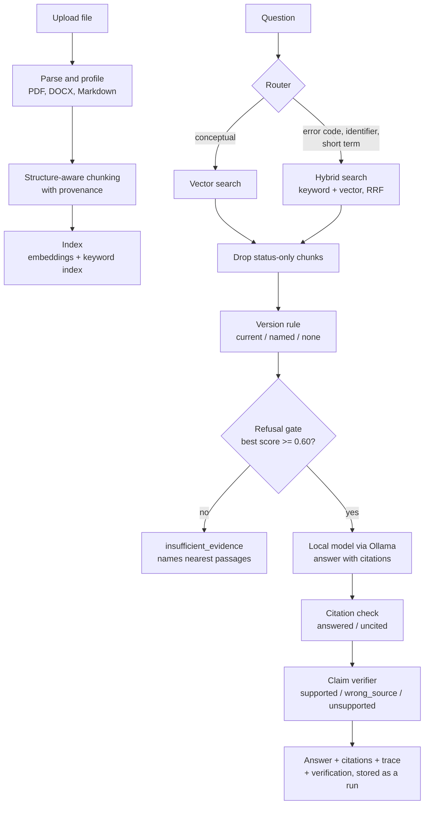

# Nexus RAG: Architecture and API

This document describes how the system is built, how a question flows through it, and what the API offers. For setup and running instructions, see `README.md`. For measured results, see the report `Nexus_RAG_Weeks_7-12.docx`.

## 1. Overview

Nexus RAG answers questions about a set of technical documents (architecture notes, decision records, incident logs, meeting notes). Every answer has to cite its sources. The system refuses to answer when the evidence is weak, and it checks each claim of an answer against the sources it retrieved.

Main design rules:

- **Provenance first.** Every chunk keeps its file, version label, status, date, heading path and page, and every answer links back to them.
- **Refuse rather than guess.** If the best chunk is below a similarity threshold, the language model is never called.
- **Retrieved text is data, not instructions.** The prompt tells the model to ignore instructions inside sources, and this was tested with a poisoned document.
- **Report, do not block.** The claim verifier adds a verdict per claim, but never changes the answer.

## 2. Request flow

Steps in more detail:

1. **Ingestion.** Files are parsed, profiled (language, length, missing metadata, duplicates) and recorded. A corrupted or empty file is recorded as `failed` or `empty` and never stops the upload.
2. **Chunking.** Chunks follow the document structure (headings and paragraphs) and never cross a section boundary. Long paragraphs are split with a 30-word overlap. Chunk size is capped at 180 words.
3. **Indexing.** Embeddings use `BAAI/bge-small-en-v1.5`. A keyword index is built alongside. Indexing is idempotent, so running it twice is safe.
4. **Routing.** In `auto` mode a rule-based router sends error codes, identifiers, snake_case terms and short terms to hybrid search, and conceptual questions to vector search. The chosen route and the reason are stored in the trace.
5. **Filtering.** Chunks that contain only header lines (for example "Status: Approved") are removed, because they score high but contain no answer.
6. **Version rule.** The question is classified as *current* ("currently", "latest"), *named* ("in v3") or *none*. For *current*, only the best version of each document family is kept (approved before draft, then newest). For *named*, only that version is kept. The dropped files are listed in the trace.
7. **Refusal gate.** The similarity score of the best remaining chunk must reach `MIN_VECTOR_SCORE` (0.60). Otherwise the answer is `insufficient_evidence`, with a message that names the nearest passages.
8. **Generation.** A local model (`qwen2.5:3b` through Ollama, temperature 0) answers from numbered sources. It must cite like `[1]` and reply `INSUFFICIENT_EVIDENCE` if the sources do not contain the answer.
9. **Citation check.** An answer with at least one valid citation and at least 3 words besides the citations is `answered`. Otherwise it is `uncited`.
10. **Claim verification.** List sentences and two-clause sentences are split into smaller claims. A small NLI model (`cross-encoder/nli-deberta-v3-small`) scores each claim against each retrieved source. Each claim gets the verdict `supported`, `wrong_source` (true, but the cited source does not say it) or `unsupported`.
11. **Storage.** Every query is saved as a run (question, mode, evidence, status, answer, trace, timings) and can be read back later.

## 3. Components

The table lists the modules in `app/`.

| Module | Responsibility |
|---|---|
| `main.py` | FastAPI application, authentication header, request IDs, core routes; registers the three modules below |
| `feedback.py` | Stores user ratings and issue reports for a run (`POST /api/v1/feedback`) |
| `analytics.py` | Retrieval and feedback statistics for a workspace (`GET /api/v1/analytics/retrieval`) |
| `explorer.py` | Serves the evidence explorer page (`/explorer`) from `app/static/explorer.html` |
| `config.py` | Settings: paths, chunk size, embedding model, Ollama address, model name, gate threshold |
| `db.py` | PostgreSQL access: workspaces, documents, versions, chunks, runs |
| `parsing.py` | Reads PDF, DOCX and Markdown; builds the heading path |
| `ingest.py` | Upload handling, hashing, metadata extraction, failure recording |
| `profiling.py` | Corpus profile: file types, languages, missing metadata, duplicates |
| `chunking.py` | Structure-aware and fixed-size chunking, deterministic chunk ids |
| `embeddings.py` | Embedding model loading and encoding |
| `indexing.py` | Builds the vector and keyword indexes for a workspace |
| `search.py` | Vector search and keyword search |
| `hybrid.py` | Hybrid search with Reciprocal Rank Fusion |
| `rerank.py` | Optional cross-encoder reranking (measured, not used by default) |
| `router.py` | Chooses vector or hybrid search for a question and gives a reason |
| `versions.py` | Version intent detection and the current / named version rule |
| `answering.py` | The full question pipeline: retrieve, filter, gate, generate, check, verify, store |
| `llm.py` | Calls the local Ollama model |
| `verify.py` | Claim splitting and NLI-based verification |

## 4. Authentication and access

Every request needs an `X-User-Id` header, and a request without it returns 401. Workspaces, documents, chunks and runs belong to the user who created them. Another user gets 404, not 403, so the existence of a resource is not revealed. This is covered by tests for workspaces, documents, search, chunks and runs.

This is a lightweight identity check suitable for a prototype. It is not real authentication, because the header is not verified. A production system would replace it with proper login and token checks.

## 5. API

All paths below start at the server root, for example `http://127.0.0.1:8000`. Interactive documentation with exact request and response schemas is served at `/docs`.

| Method | Path | Purpose |
|---|---|---|
| GET | `/health` | Liveness check |
| POST | `/api/v1/workspaces` | Create a workspace. Body: `{"name": "..."}`. Returns 201 with `workspace_id` |
| POST | `/api/v1/documents/upload?workspace_id=...` | Upload one file as multipart form data (field `file`). Returns 201. Unsupported types return 415, and corrupted files are recorded as failed |
| GET | `/api/v1/documents` | List documents |
| GET | `/api/v1/documents/{version_id}` | Metadata and processing status of one document version |
| GET | `/api/v1/analytics/corpus?workspace_id=...` | Corpus profile and quality statistics |
| GET | `/api/v1/analytics/retrieval?workspace_id=...` | Retrieval metrics from stored runs, and a summary of user feedback |
| POST | `/api/v1/workspaces/{workspace_id}/index` | Build the indexes. Optional query parameter `embed` (set `false` to skip embeddings, used in tests) |
| POST | `/api/v1/search` | Retrieval without answer generation |
| POST | `/api/v1/query` | Ask a question. Body: `workspace_id`, `question`, `mode` (`auto`, `vector` or `keyword`), `k` |
| GET | `/api/v1/runs/{run_id}` | Read a stored run: status, answer, evidence, trace, timings |
| GET | `/api/v1/chunks/{chunk_id}` | Read the exact text of a cited chunk |
| POST | `/api/v1/feedback` | Submit feedback on a run. Body: `run_id`, `rating`, `issue_type`, `comment`. Returns 201 with `feedback_id`. Feedback on another user's run returns 404 and an invalid rating returns 422 |
| GET | `/explorer` | Evidence explorer web page (not part of the JSON API and hidden from `/docs`) |

### Query response

| Field | Meaning |
|---|---|
| `run_id` | Id of the stored run |
| `status` | `answered`, `uncited` or `insufficient_evidence` |
| `answer` | The answer text, or the refusal message |
| `citations` | The evidence entries that the answer cites (file, version, section, page, score, chunk id) |
| `evidence` | All evidence given to the model |
| `invalid_citations` | Citation numbers in the answer that do not match any source |
| `model` | Model name, or `null` if the model was not called |
| `trace` | Route and reason, version decision, gate score and threshold, and timings (`retrieve_ms`, `generate_ms`, `verify_ms`, `total_ms`) |
| `verification` | One entry per claim with `verdict`, cited sources, better sources and scores. `null` unless the status is `answered` |

## 6. What is implemented and what is not

| Blueprint item | State |
|---|---|
| Upload, parsing, profiling, duplicate detection | Implemented |
| Structure-aware chunking | Implemented and measured against fixed-size chunks |
| Dense, keyword and hybrid retrieval | Implemented and measured |
| Reranking | Implemented and measured. It did not help on this corpus and costs the most time |
| Adaptive query routing | Implemented as a rule-based router. It had the best score in the ablation, though the advantage may be chance |
| Version-aware retrieval | Implemented for current and named versions |
| Citations that open the exact passage | Implemented through `/api/v1/chunks/{chunk_id}` |
| Refusal when evidence is weak | Implemented with a 0.60 gate |
| Claim-level verification | Implemented with an NLI model and simple claim splitting |
| Corpus analytics, run history, user feedback | Implemented |
| Knowledge graph and graph traversal | Not built. The blueprint defers it until the baseline is reliable |
| Temporal reasoning beyond version selection | Not built |
| Learned query planning, supervised and unsupervised models | Not built |
| Dashboard | Only a single evidence explorer page (`/explorer`). The React dashboard with an evaluation lab, graph view and observability screens was not built |

## 7. Known limitations

- The corpus has 13 documents and the results may not carry over to larger collections.
- The similarity gate can refuse short, vague questions. "What changed in v3?" scored 0.533 against a gate of 0.60.
- Version detection depends on trigger words.
- The claim splitting rule is a heuristic that handles list sentences and two clear clauses only.
- The `X-User-Id` header is not real authentication.

See the report for the full list with measurements.
